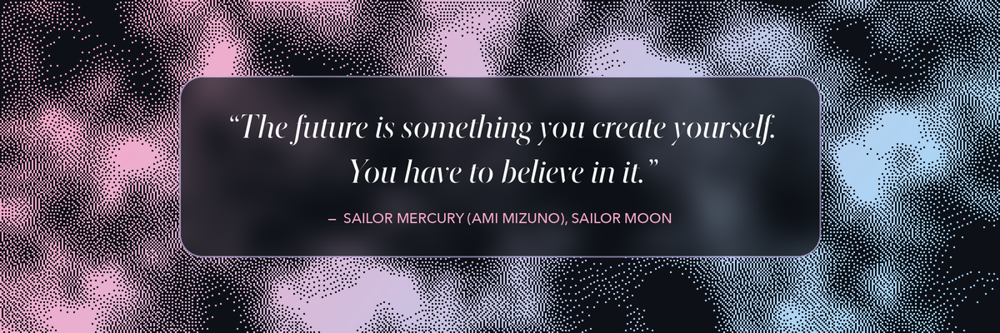

<picture>
  <source media="(prefers-color-scheme: dark)" srcset="assets/banner-quote-dark.png" />
  <source media="(prefers-color-scheme: light)" srcset="assets/banner-quote-light.png" />
  
</picture>

  <picture><source media="(prefers-color-scheme: dark)" srcset="https://readme-typing-svg.herokuapp.com?font=Poppins&weight=600&size=30&height=60&vCenter=true&color=F7A8C8&duration=1&pause=1000&repeat=false&center=true&width=600&lines=hi%2C+I'm+Jimena+Roman" /><source media="(prefers-color-scheme: light)" srcset="https://readme-typing-svg.herokuapp.com?font=Poppins&weight=600&size=30&height=60&vCenter=true&color=D9709F&duration=1&pause=1000&repeat=false&center=true&width=600&lines=hi%2C+I'm+Jimena+Roman" /></picture>
   
  <picture><source media="(prefers-color-scheme: dark)" srcset="https://readme-typing-svg.herokuapp.com?font=Poppins&weight=600&size=30&height=60&vCenter=true&color=F7A8C8&duration=1&pause=1000&repeat=false&width=208&lines=right+now+I'm" /><source media="(prefers-color-scheme: light)" srcset="https://readme-typing-svg.herokuapp.com?font=Poppins&weight=600&size=30&height=60&vCenter=true&color=D9709F&duration=1&pause=1000&repeat=false&width=208&lines=right+now+I'm" /></picture><picture><source media="(prefers-color-scheme: dark)" srcset="https://readme-typing-svg.herokuapp.com?font=Poppins&weight=600&size=30&height=60&vCenter=true&color=F7A8C8&duration=2600&pause=1200&width=400&lines=building+a+future...;practicing+LeetCode...;running+by+the+Point...;learning+system+design...;studying+for+an+exam...;planning+a+hike...;enjoying+a+bagel..." /><source media="(prefers-color-scheme: light)" srcset="https://readme-typing-svg.herokuapp.com?font=Poppins&weight=600&size=30&height=60&vCenter=true&color=D9709F&duration=2600&pause=1200&width=400&lines=building+a+future...;practicing+LeetCode...;running+by+the+Point...;learning+system+design...;studying+for+an+exam...;planning+a+hike...;enjoying+a+bagel..." /></picture>

  

    
    
  

 

<picture>
  <source media="(prefers-color-scheme: dark)" srcset="https://raw.githubusercontent.com/jimenaroman/jimenaroman/output/snake-dark.svg" />
  <source media="(prefers-color-scheme: light)" srcset="https://raw.githubusercontent.com/jimenaroman/jimenaroman/output/snake-light.svg" />
  
</picture>
